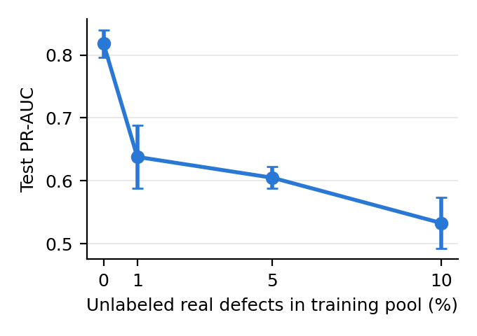
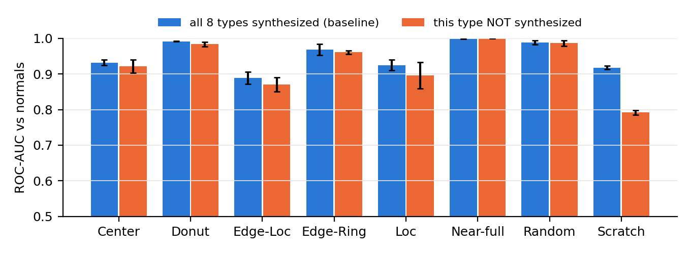

# Ablation Study（Tier 2：CNN＋合成 defect）

> 每個 ablation **只改一個因素**，其他設定和 Tier 2 預設完全相同（3 個 seed、同一個 split、τ = val best-F1、同一個 `evaluate.py`）。
> 第 1 節是總表，第 2–5 節各是一個 ablation，可以直接寫進 paper §7。
>
> 對應程式：[`src/CNN.py`](../src/CNN.py)（`--contam`、`--drop-types`、`--binary`）、[`src/ablation.py`](../src/ablation.py)｜執行腳本：[`scripts/run_tier3_ablation.sh`](../scripts/run_tier3_ablation.sh)
> 最後更新：2026-10-28

---

## TL;DR

| # | Ablation | 類型 | 主要結果 |
|---|---|---|---|
| A1 | **訓練資料污染**（normal pool 混入 1 / 5 / 10% 未標註的真實 defect） | AD-specific | **只要 1% 污染，PR-AUC 就從 0.818 掉到 0.638（−0.180）**，10% 時 0.533。遠大於 seed std |
| A2 | **Leave-one-type-out**（某一類 defect 不合成） | AD-specific | 8 類中有 6 類即使**沒合成也偵測得到**（ROC-AUC 掉 < 0.02）。只有 **Scratch 明顯依賴合成**（0.918 → 0.792）。但拿掉合成 Scratch 後，**整體 PR-AUC 反而上升 +0.063**（誤報減少） |
| A3 | 分類頭：9 類 vs 2 類（none / defect） | 設計選擇 | −0.020，**在 seed 波動內**，9 類沒有顯著幫助 |
| A4 | **Threshold 策略**（同一組模型，只換 τ 的選法） | AD-specific | best-F1 和「FPR 預算 5%」的 F1 相當（0.747 / 0.745）；FPR 預算 1% 時 precision 0.91 但 recall 只剩 0.51 |
| — | Conv AE vs 合成 defect CNN（已在 [tier2.md](tier2.md) §6） | 方法家族 | AE 0.462，比合成 defect 低 0.356 |

---

## 1. 總表（retrained ablations）

來源：`results/ablation/summary.csv`。**Baseline = Tier 2 預設設定在同一台機器（RTX 4090）上重跑**，所以所有 Δ 都是同硬體、同軟體下的比較。（Colab 原本的 Tier 2：0.818 ± 0.014；4090 重跑：0.818 ± 0.022，一致。）

| 設定 | 改變的因素 | PR-AUC | Δ vs baseline | Welch p | \|Δ\| > seed std？ | ROC-AUC | F1 | Recall | FPR |
|---|---|---:|---:|---:|:---:|---:|---:|---:|---:|
| **baseline** | — | **0.818 ± 0.022** | — | — | — | 0.939 | 0.748 | 0.741 | 0.041 |
| binary | 2 類 head | 0.798 ± 0.006 | −0.020 | 0.32 | 否 | 0.936 | 0.730 | 0.726 | 0.046 |
| contam 1% | 污染 | 0.638 ± 0.050 | **−0.180** | 0.023 | **是** | 0.881 | 0.600 | 0.613 | 0.076 |
| contam 5% | 污染 | 0.605 ± 0.017 | **−0.213** | < 0.001 | **是** | 0.854 | 0.582 | 0.584 | 0.073 |
| contam 10% | 污染 | 0.533 ± 0.040 | **−0.285** | 0.003 | **是** | 0.820 | 0.522 | 0.540 | 0.093 |
| drop Center | 不合成 Center | 0.819 ± 0.014 | +0.001 | 0.97 | 否 | 0.936 | 0.751 | 0.740 | 0.040 |
| drop Donut | 不合成 Donut | 0.819 ± 0.043 | +0.001 | 0.98 | 否 | 0.937 | 0.751 | 0.733 | 0.038 |
| drop Edge-Loc | 不合成 Edge-Loc | 0.805 ± 0.032 | −0.013 | 0.66 | 否 | 0.935 | 0.734 | 0.733 | 0.046 |
| drop Edge-Ring | 不合成 Edge-Ring | 0.808 ± 0.011 | −0.010 | 0.60 | 否 | 0.940 | 0.748 | 0.744 | 0.043 |
| drop Loc | 不合成 Loc | 0.787 ± 0.029 | −0.031 | 0.30 | 是（勉強） | 0.926 | 0.703 | 0.671 | 0.041 |
| drop Near-full | 不合成 Near-full | 0.843 ± 0.018 | +0.025 | 0.28 | 是（勉強） | 0.945 | 0.774 | 0.741 | 0.030 |
| drop Random | 不合成 Random | 0.814 ± 0.021 | −0.004 | 0.86 | 否 | 0.934 | 0.749 | 0.725 | 0.037 |
| drop Scratch | 不合成 Scratch | **0.881 ± 0.004** | **+0.063** | 0.053 | **是** | 0.959 | 0.808 | 0.770 | **0.023** |

「\|Δ\| > seed std」用的是 baseline 和該設定兩者 std 中較大的那個。只有 3 個 seed，Welch p 的檢定力很低，所以 p 在 0.05 附近的結果（drop Scratch）要寫成「趨勢一致、接近顯著」，不要寫成確定的結論。

---

## 2. A1：訓練資料污染（`--contam`）

**問題**：Tier 2 假設 normal pool 是乾淨的。如果有一部分 defect 晶圓沒被標出來、被當成 normal 一起訓練，會怎樣？這在實務上很常見：WM-811K 有 638k 片晶圓**沒有 label**，不能直接當 normal 用。

**做法**：從 **train** 的 defect 晶圓隨機抽樣（固定 seed 0），混進 train normal pool，佔 pool 的 1% / 5% / 10%（889 / 4,630 / 9,774 片）。這些晶圓被當成 normal（target = none），也可能被畫上合成 defect，和 normal 完全一樣處理。val / test 不變。



| 污染比例 | PR-AUC | Δ | ROC-AUC | FPR |
|---:|---:|---:|---:|---:|
| 0%（baseline） | 0.818 ± 0.022 | — | 0.939 | 0.041 |
| 1% | 0.638 ± 0.050 | −0.180 | 0.881 | 0.076 |
| 5% | 0.605 ± 0.017 | −0.213 | 0.854 | 0.073 |
| 10% | 0.533 ± 0.040 | −0.285 | 0.820 | 0.093 |

**解讀：**
- **極度敏感**：1% 污染就損失 PR-AUC 的一大半提升（T1 → T2 的 +0.344 中掉了 0.180）。原因是合成 defect 方法的訓練目標是「真實 defect 樣子 = none、合成 defect 樣子 = defect」：混進來的真實 defect 被明確標成 none，等於**直接教模型把真實 defect 判成正常**。這比 reconstruction 方法（只是「也學會重建 defect」）的傷害更直接。
- 第一個 1% 的傷害最大（−0.18），之後每多 5% 只再掉約 0.04–0.07：少量真實 defect 已經足以讓模型學到「這種形狀是 none」。
- 誤報率也上升（0.041 → 0.076–0.093），因為 τ 在 val 上選 best-F1，模型分數分離度變差時 τ 會往下移。
- **實務意義**：部署前**清理 normal pool 比調模型重要得多**。若要使用未標註晶圓擴充訓練資料，必須先過濾（例如先用 Tier 1 fail rate 或 T2 本身把高分的晶圓剔除），否則會嚴重退化。

---

## 3. A2：Leave-one-type-out（`--drop-types T`）

**問題**：T2 能偵測**沒看過（沒合成過）的 defect 類型**嗎？還是只是在辨認我們手工畫的 8 種形狀？這也是 one-class / self-supervised 方法相對監督式 T3 的主要賣點。

**做法**：每次拿掉一種合成類別（其餘 7 類機率相同、synth 比例仍為 50%），重新訓練 3 個 seed。用 **該類別真實 test 晶圓 vs 全部 test normal 的 ROC-AUC** 衡量（不受 τ 影響）。



來源：`results/ablation/leave_one_out.csv`

| 不合成的類別 | 該類 ROC-AUC：baseline | 該類 ROC-AUC：不合成 | Δ | 其他 7 類平均 Δ | 整體 PR-AUC Δ |
|---|---:|---:|---:|---:|---:|
| Center | 0.932 ± 0.008 | 0.922 ± 0.018 | −0.010 | −0.004 | +0.001 |
| Donut | 0.992 ± 0.000 | 0.984 ± 0.006 | −0.008 | −0.005 | +0.001 |
| Edge-Loc | 0.889 ± 0.017 | 0.871 ± 0.020 | −0.018 | −0.004 | −0.013 |
| Edge-Ring | 0.968 ± 0.016 | 0.961 ± 0.005 | −0.007 | +0.001 | −0.010 |
| Loc | 0.925 ± 0.015 | 0.896 ± 0.037 | −0.029 | −0.013 | −0.031 |
| Near-full | 0.999 ± 0.001 | 1.000 ± 0.000 | +0.001 | +0.003 | +0.025 |
| Random | 0.988 ± 0.006 | 0.987 ± 0.008 | −0.002 | −0.006 | −0.004 |
| **Scratch** | **0.918 ± 0.005** | **0.792 ± 0.006** | **−0.126** | **+0.018** | **+0.063** |

**解讀：**
1. **大多數類別可以泛化到沒合成過的情況**。Center、Donut、Edge-Ring、Near-full、Random 不合成時 ROC-AUC 幾乎不變（|Δ| ≤ 0.01）。原因是類別之間形狀有重疊：Donut ≈ 環狀的 Center / Edge-Ring，Near-full ≈ 高密度的 Random，Edge-Ring ≈ 填滿整圈的 Edge-Loc。模型學到的是「**不良 die 在空間上聚集**」這個共通概念，而不是 8 個獨立的模板。
2. **Loc、Edge-Loc 有中度依賴**（−0.029 / −0.018），它們是「局部團塊」，和其他類別的形狀最不像。
3. **Scratch 是唯一無法泛化的類別**（−0.126，遠大於 seed std 0.006）。細長的線條在其他 7 類中都沒有對應，GlobalMaxPool CNN 沒看過就不會把它當成異常。
4. **但拿掉合成 Scratch 反而讓整體變好**（PR-AUC +0.063、FPR 0.041 → 0.023、其他類 ROC-AUC 平均 +0.018）。最可能的原因：合成 Scratch 只有 2–3 px 寬，normal 晶圓中隨機壞 die「剛好排成一小段直線」的情況很常見，模型學會對這種局部線條反應後，normal 的分數整體被拉高、誤報增加。**合成 Scratch 用誤報換到了 Scratch recall**。Scratch 只佔 test defect 的 4.9%（251 / 5,096），所以整體 PR-AUC 是淨損失。
   - 這是一個 **trade-off，不是單純的「拿掉比較好」**：如果 Scratch 對產線很重要（例如代表機台搬運刮傷），仍應保留它。
   - §8 error analysis 可以驗證：從 `results/tier2/synth/scores_test.csv` 挑出 baseline 分數高、但 `drop_Scratch` 分數低的 normal（FP），看是否有線狀的壞 die。
5. Near-full 拿掉後整體也 +0.025（勉強超過 seed std）：Near-full 只有 31 片 test，本來就會被 Random 的合成版本涵蓋；省下的合成比例分給其他類別。

---

## 4. A3：9 類 vs 2 類分類頭（`--binary`）

**問題**：模型需要知道「合成的是哪一類」嗎？還是只要知道「有沒有 defect」就夠？

**做法**：合成方式完全相同，只是 target 從 0–8 改成 0 / 1，head 輸出 2 類。Score 公式不變（2 類時 = $z_1 - z_0$）。

| head | PR-AUC | Δ | ROC-AUC | F1 |
|---|---:|---:|---:|---:|
| 9 類（baseline） | 0.818 ± 0.022 | — | 0.939 | 0.748 |
| 2 類 | 0.798 ± 0.006 | −0.020 | 0.936 | 0.730 |

**解讀**：9 類平均高 0.020，但在 seed std（0.022）之內，p = 0.32，**不能宣稱 9 類有幫助**。9 類 head 的好處是可以順便輸出「疑似哪一類」給工程師參考，不影響偵測效能。這是誠實的 negative result。

---

## 5. A4：Threshold 策略（不重新訓練）

**問題**：τ 的選法對實際運作的影響有多大？

**做法**：用 Tier 2 的 3 個模型（`results/tier2/synth/model_seed*.pt`），在 **val** 上用 5 種規則選 τ，再到 test 上評估。分數完全相同，所以 PR-AUC 不變，只有 threshold 相關的指標會變。來源：`results/ablation/threshold.csv`。

| τ 規則（只用 val） | Precision | Recall | F1 | FPR | 每 1000 片的警報數 |
|---|---:|---:|---:|---:|---:|
| **best F1（預設）** | 0.757 ± 0.016 | 0.738 ± 0.010 | **0.747 ± 0.008** | 0.041 | 144 |
| val normal 平均 + 3 std | 0.890 ± 0.010 | 0.544 ± 0.037 | 0.674 ± 0.030 | 0.012 | 90 |
| FPR 預算 5%（val normal q95） | 0.733 ± 0.005 | **0.758 ± 0.009** | 0.745 ± 0.007 | 0.048 | 153 |
| FPR 預算 1%（val normal q99） | **0.908 ± 0.007** | 0.513 ± 0.042 | 0.655 ± 0.037 | **0.009** | 83 |
| 審查預算：每 10% 晶圓發警報 | 0.868 ± 0.016 | 0.592 ± 0.013 | 0.704 ± 0.014 | 0.016 | 101 |

**解讀：**
- **FPR 預算在 test 上有被遵守**：設定 5% → test 4.8%，設定 1% → test 0.9%。因為 split 以 lot 分組且 val / test 分布接近，val normal 的分位數可以直接當成誤報率的控制旋鈕。這對部署很重要：工程師可以直接指定「每天最多能接受多少誤報」。
- best-F1 和 FPR 5% 幾乎一樣（F1 0.747 vs 0.745），代表 best-F1 選到的點剛好落在約 4% 的誤報率。
- **3σ 規則（Tier 1 用過的）不適合 T2**：T2 的 normal 分數分布有長尾，mean + 3 std 實際只對應約 1.2% 誤報率，recall 掉到 0.54。
- **營運上的選擇**：若 defect 漏抓的代價高（例如整批報廢），用 best-F1 / FPR 5%；若人工複檢人力有限，用 FPR 1%（每 1000 片只需看 83 片，其中 91% 是真的 defect）。

---

## 6. 給 paper 的素材

- **§7 Ablation 表**：第 1 節的總表（可以只放 baseline、binary、contam 三列、drop Loc / Scratch 兩列，其餘放 appendix 或一句話帶過），附 Δ 和「是否超過 seed std」。
- **§7 圖**：`figures/ablation/contamination.{png,pdf}`、`figures/ablation/leave_one_out.{png,pdf}`。
- **§8 Analysis**：A2 第 4 點（合成 Scratch 造成 FP 的假設），可以用 FP 案例驗證；A4 的營運解讀放 §8 Practical Impact。
- **§9 Conclusion / Limitations**：A1 是最重要的部署限制（normal pool 必須乾淨）；A2 顯示對新 defect 類型的泛化能力，但線狀 defect 是盲點。
- **Future work**（對應 A2）：讓合成 Scratch 更接近真實（較長、斷續、配合 hard-negative：在 normal 上畫「不是 defect 的短線」），同時保留 Scratch recall 和低誤報。

### 重現

```bash
bash scripts/run_tier3_ablation.sh   # 全部 retrained ablation（+ Tier 3），RTX 4090 約 21 分鐘；重跑會跳過已完成的 seed
python src/ablation.py               # 總表、leave-one-out、threshold ablation、圖
```
