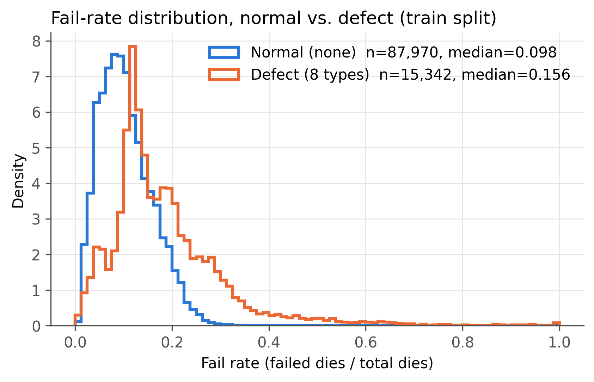
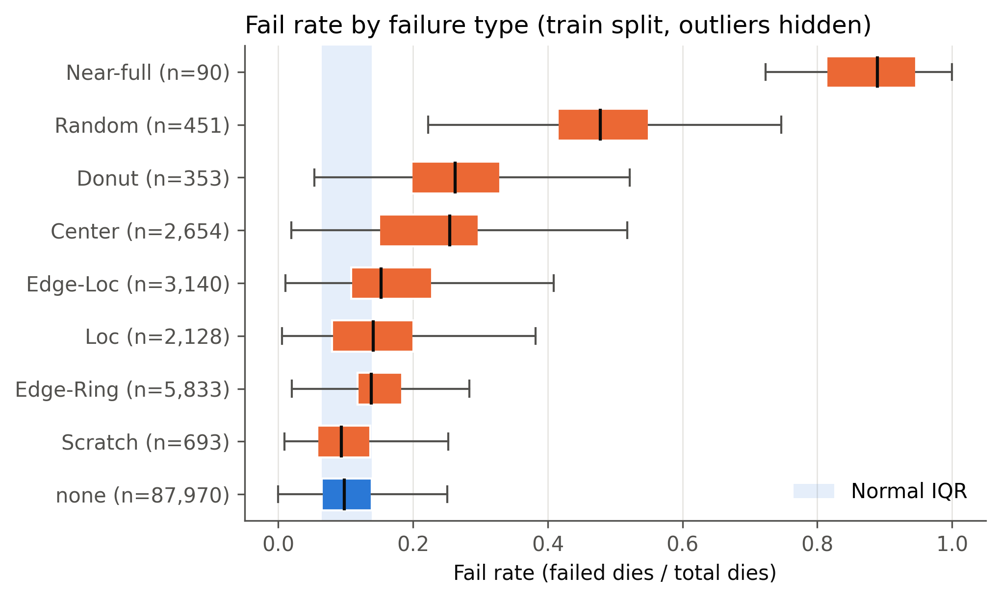
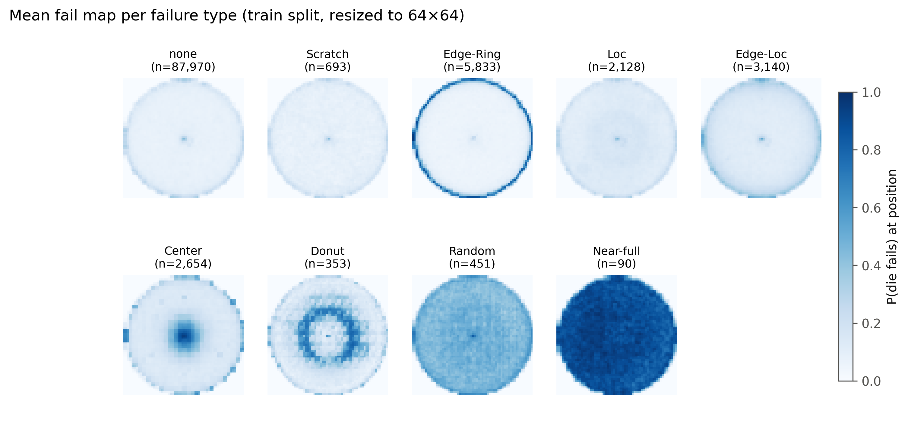

# EDA：探索性特徵分析（train split only）

> 給組員：這份整理 EDA 的結果與結論，對應 paper **§4 Exploratory Feature Analysis**（10 分）。重點在第 6 節「對建模的啟示」，供Tier 2/3 設計時參考。
>
> 對應程式：[`notebooks/02_eda.ipynb`](../notebooks/02_eda.ipynb)
> 圖：`figures/eda/`（PNG + PDF，PDF 可直接放 LaTeX）｜表：`results/eda/`
> 最後更新：2026-10-24

---

## TL;DR

- **所有統計只用 train split**（103,312 片：87,970 normal / 15,342 defect），val/test 完全沒有碰（作業規定）。
- **只看「壞多少」不夠**：fail rate 單一特徵的整體 AUROC 只有 **0.74**，Scratch 甚至是 **0.48**（等於隨機猜）。
- **位置資訊很有用**：加上外圈 / 中心的 fail rate，Edge-Ring 的 AUROC 從 0.73 升到 **0.93**，Center 從 0.85 升到 **0.95**。
- **結論**：anomaly 是**空間 pattern**，模型需要看整張圖（CNN / Autoencoder），而不是只看幾個統計量。
- **Scratch 最難**：所有簡單特徵都失效，預期是 false negative 的主要來源。
- **意外發現**：defect 比例會隨 dieSize 上升（9% → 30%），是潛在的捷徑特徵（shortcut）。

---

## 1. 如何重現

1. 前提：`data/LSWMD_clean.pkl` 和 `splits/split_v1.csv` 已存在（見 [data_notes.md](data_notes.md)、[split.md](split.md)）
2. 依序執行 `notebooks/02_eda.ipynb` 的所有 cell，約 1–2 分鐘
3. 輸出：

| 檔案 | 內容 |
|---|---|
| `figures/eda/fig1_failrate_normal_vs_defect.{png,pdf}` | Fig 1 |
| `figures/eda/fig2_failrate_by_type.{png,pdf}` | Fig 2 |
| `figures/eda/fig3_mean_fail_map_by_type.{png,pdf}` | Fig 3 |
| `results/eda/table1_separability.csv` | Table 1（完整版，含 KS / W1 / AUROC） |
| `results/eda/table2_feature_corr.csv` | Table 2 |

---

## 2. 特徵定義

每片晶圓計算以下特徵（只用來做 EDA，不代表模型一定要用）：

| 特徵 | 定義 | 想檢查什麼 |
|---|---|---|
| `fail_rate` | 不良 die 數 / die 總數 | 整體壞多少（**Tier 1 用的特徵**） |
| `edge_fail_rate` | 外圈（正規化半徑 r > 0.8）的 fail rate | Edge-Ring / Edge-Loc |
| `center_fail_rate` | 中心（r < 0.3）的 fail rate | Center / Donut |
| `dieSize` | die 總數 | 產品差異是否和 defect 有關 |

**正規化半徑 r**：以所有 die（像素值 > 0）的幾何中心為圓心，最遠的 die 距離設為 1。

### 各類別中位數

| failureType | fail_rate | edge_fail_rate | center_fail_rate | dieSize |
|---|---:|---:|---:|---:|
| none | 0.098 | 0.157 | 0.086 | 776 |
| Scratch | 0.094 | 0.137 | 0.075 | 1129 |
| Edge-Ring | 0.138 | **0.320** | 0.054 | 2085 |
| Loc | 0.141 | 0.174 | 0.116 | 939 |
| Edge-Loc | 0.153 | **0.278** | 0.100 | 939 |
| Center | 0.254 | 0.282 | **0.583** | 515 |
| Donut | 0.262 | 0.159 | 0.215 | 1334 |
| Random | 0.478 | 0.512 | 0.486 | 1080 |
| Near-full | 0.889 | 0.895 | 0.948 | 741 |

---

## 3. 分布對比

### Fig 1：Normal vs Defect 的 fail rate 分布

**解讀：**
- Normal 的 fail rate 集中在 0.05–0.15（中位數 0.098）。**normal 晶圓本來就有大約 10% 的壞 die**，是正常的良率損失。
- Defect 中位數 0.156，整體偏右，而且有一條很長的右尾（Random、Near-full 造成的）。
- **兩個分布在 0.1–0.2 之間大量重疊**：大多數 defect 的 fail rate 和 normal 差不多，只靠門檻（Tier 1）會有很多漏抓。
- 用 density（面積 = 1）而不是次數，因為 normal 筆數是 defect 的 5.7 倍，用次數畫 defect 會被壓扁。

### Fig 2：各類別的 fail rate

**解讀：**（淡藍色帶 = normal 的 IQR，25–75 百分位）
- **可以分開**：Near-full、Random 的整個箱子都在 normal 範圍之外；Donut、Center 大致分開。
- **嚴重重疊**：Scratch 的箱子幾乎和 normal 完全重合（中位數 0.094，甚至比 normal 的 0.098 低）；Edge-Ring、Loc、Edge-Loc 也大幅重疊。
- 偏偏 Edge-Ring（5,833）、Edge-Loc（3,140）、Loc（2,128）是**數量最多的 defect**，所以 Tier 1 的整體 recall 會被它們拖低。

---

## 4. Table 1：分離度量化

每一類 defect 都和 normal 比較。三個指標：
- **KS**：兩個分布 CDF 的最大差距（0 = 相同，1 = 完全分開）
- **W1**：Wasserstein 距離（單位與特徵相同）
- **AUROC**：只用這一個特徵當 anomaly score 的 ROC-AUC（0.5 = 隨機；< 0.5 = 方向相反，也就是 defect 的值反而比較低）

### AUROC（最直觀，粗體 = 該類最佳特徵）

| failureType | n | fail_rate | edge_fail_rate | center_fail_rate |
|---|---:|---:|---:|---:|
| Scratch | 693 | **0.481** | 0.447 | 0.465 |
| Edge-Ring | 5,833 | 0.733 | **0.933** | 0.357 |
| Loc | 2,128 | **0.636** | 0.543 | 0.584 |
| Edge-Loc | 3,140 | 0.741 | **0.833** | 0.570 |
| Center | 2,654 | 0.849 | 0.762 | **0.954** |
| Donut | 353 | **0.950** | 0.553 | 0.765 |
| Random | 451 | **0.999** | 0.988 | 0.993 |
| Near-full | 90 | **1.000** | 1.000 | 1.000 |
| **ALL defects** | 15,342 | 0.744 | **0.800** | 0.572 |

### KS 統計量

| failureType | fail_rate | edge_fail_rate | center_fail_rate |
|---|---:|---:|---:|
| Scratch | 0.051 | 0.117 | 0.090 |
| Edge-Ring | 0.427 | 0.775 | 0.246 |
| Loc | 0.262 | 0.121 | 0.216 |
| Edge-Loc | 0.331 | 0.513 | 0.112 |
| Center | 0.626 | 0.480 | 0.795 |
| Donut | 0.756 | 0.125 | 0.448 |
| Random | 0.982 | 0.911 | 0.936 |
| Near-full | 1.000 | 1.000 | 1.000 |
| ALL defects | 0.367 | 0.520 | 0.219 |

W1 完整數值請見 `results/eda/table1_separability.csv`。

**解讀：**
- **不同 defect 需要不同特徵**：Edge-Ring / Edge-Loc 靠外圈，Center 靠中心，Random / Near-full / Donut 靠整體 fail rate。**沒有任何單一特徵能涵蓋所有類別**。
- **Edge-Ring 的 `center_fail_rate` AUROC 是 0.357（< 0.5）**：Edge-Ring 晶圓的中心反而比 normal 更乾淨（中位數 0.054 vs 0.086），壞 die 都集中到外圈了。
- **Scratch 三個特徵全部約 0.45–0.48**，KS 最大也只有 0.12：簡單統計量完全看不出 Scratch。
- 注意：這裡的 AUROC 是在 **train** 上算的，只是預覽。正式數字以 Tier 1 在 test 上的結果為準。

---

## 5. 空間 pattern 與冗餘檢查

### Fig 3：各類別的平均 fail 空間分布

做法：每張 wafer map 用 **nearest-neighbor** 縮放到 64×64（像素值是類別，不能用 bilinear），取 `== 2` 的二值圖，每一類最多隨機取 3,000 張平均。顏色越深 = 該位置越常壞。

**解讀：**
- **none**：整片均勻的淡色。壞 die 隨機分布，沒有固定位置。
- **Edge-Ring**：外圈一整圈深色，pattern 非常清楚。
- **Edge-Loc**：外圈稍深，但不是整圈（位置不固定，平均後變淡）。
- **Center**：中心一團深色。
- **Donut**：中間一圈環狀，正中心反而較淡。
- **Random**：整片中等深度，均勻地壞很多。
- **Near-full**：幾乎全部深色。
- **Scratch、Loc**：平均圖和 none **幾乎一樣**。因為刮痕或局部缺陷的位置、方向每張都不同，取平均後就被抹平了。這**不代表**它們沒有 pattern，而是 pattern 的**位置不固定**，模型需要具備平移不變性（例如 CNN）才能抓到。
- 所有類別正中心都有一個小點，推測是晶圓中心的測試 / 對位點，屬於資料特性，不是 defect。

### Table 2：特徵相關性（Spearman ρ）

| | fail_rate | edge_fail_rate | center_fail_rate | dieSize |
|---|---:|---:|---:|---:|
| fail_rate | 1.000 | **0.912** | 0.779 | -0.570 |
| edge_fail_rate | 0.912 | 1.000 | 0.600 | -0.457 |
| center_fail_rate | 0.779 | 0.600 | 1.000 | -0.578 |
| dieSize | -0.570 | -0.457 | -0.578 | 1.000 |

**解讀：**
- `fail_rate` 和 `edge_fail_rate` 的 ρ = 0.91，**高度冗餘**。外圈的 die 數本來就佔大部分，整體 fail rate 很大程度就是外圈的 fail rate。但 Table 1 顯示兩者對 Edge-Ring 的 AUROC 差了 0.2，表示「冗餘」只是針對整體排名，在特定類別上仍有額外資訊。
- `dieSize` 和 fail rate 是負相關（-0.57）：die 數越多（die 越小），fail rate 越低。

### dieSize 與 defect 比例

| dieSize 區間（五等分） | 晶圓數 | defect 比例 |
|---|---:|---:|
| 3 – 533 | 28,476 | 9.2% |
| 533 – 741 | 15,899 | 8.8% |
| 741 – 1,060 | 19,776 | 10.5% |
| 1,060 – 1,376 | 20,622 | 17.5% |
| 1,376 – 22,372 | 18,539 | **30.4%** |

**解讀：** dieSize 最大的那 1/5，defect 比例是最小那組的 3 倍以上。dieSize 代表**產品種類**，不同產品的 defect 機率本來就不同（Edge-Ring 晶圓的 dieSize 中位數 2,085，遠高於 normal 的 776）。模型如果能從輸入推出 dieSize（例如未 resize 前的 map 大小），就可能學到「這是哪種產品」而不是「有沒有 defect pattern」。

---

## 6. 假設（paper §4 → 在 §7–§8 驗證）

| # | 假設 | 證據 | 如何驗證 |
|---|---|---|---|
| **H1** | 單一 fail rate 能偵測 Near-full / Random / Donut（AUROC ≥ 0.95），但對 Scratch（0.48）、Loc（0.64）、Edge-Ring（0.73）效果差 | Table 1、Fig 2 | Tier 1 在 test 上的 **per-type recall** |
| **H2** | 位置資訊能提升 Edge-Ring（0.73 → 0.93）和 Center（0.85 → 0.95）的偵測；anomaly 本質是空間 pattern | Table 1、Fig 3 | Tier 2/3（看整張圖）vs Tier 1 的 per-type recall |
| **H3** | Scratch（和 Loc）是最難的類別，因為 pattern 細小且位置不固定 | Table 1（AUROC 0.45–0.48）、Fig 3（平均圖無結構） | §8 錯誤分析：false negative 是否集中在 Scratch / Loc |
| **H4** | dieSize（產品種類）與 defect 比例相關，可能成為捷徑特徵 | dieSize 分組表（9% → 30%） | §8：依 dieSize 分組看 FP / FN 比例 |

---

## 7. 對建模的啟示（給 Tier 2 / Tier 3）

1. **輸入要保留空間資訊**：用整張 wafer map（resize 到固定大小），不要只用統計特徵。H2 支持這點。
2. **resize 用 nearest-neighbor**：像素值 0/1/2 是類別，bilinear 會產生不存在的值。Fig 3 用 64×64 已經能清楚看出各類 pattern，可以當成目標尺寸的參考。
3. **Scratch 需要平移不變性**：pattern 位置不固定，CNN 類模型比較有機會。Autoencoder 的重建誤差可能對細線不敏感，要留意。
4. **注意 dieSize 捷徑（H4）**：resize 會抹掉原始尺寸資訊，算是一種保護。如果有人要另外加 dieSize 當特徵，要意識到這個風險。
5. **報告時要做 per-type 分析**：只看整體分數會被數量多的 Edge-Ring 主導，Scratch、Near-full 這些稀有類別的表現會被埋掉。

---

