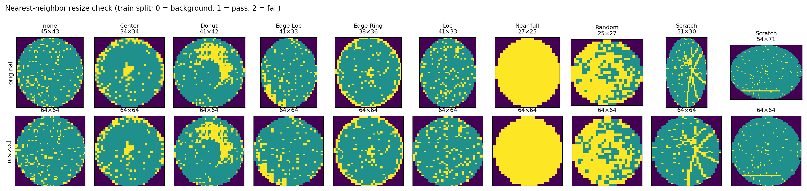

# Preprocessing：統一成 64×64 的模型輸入

> **Tier 2/3 請直接用 `data/processed/*.npz` 當輸入**，不用再讀 2GB 的 pkl，也不用自己處理尺寸不一的問題。第 4 節是載入方式。
>
> 對應程式：[`src/preprocess.py`](../src/preprocess.py)（產生檔案）、[`src/data.py`](../src/data.py)（載入工具）
> 最後更新：2026-10-24

---

## TL;DR

- 172,950 片有 label 的 wafer map，全部用 **nearest-neighbor** resize 成 **64×64**，依 split 存成 3 個 `.npz`。
- 像素值保持 **{0, 1, 2}**（背景 / 良品 / 不良），存成 `uint8`。要轉成 one-hot 或 fail 二值圖，用 `data.py` 的工具函式。
- **三個檔加起來只有約 38 MB**（壓縮後），每個檔都小於 GitHub 的 100MB 上限，**可以放進 repo**。組員 clone 下來就能用，不必下載 Kaggle 原檔。
- 檢查都通過：像素值只有 0/1/2；fail rate 平均只變動 0.0027；沒有任何晶圓的 fail die 在 resize 後完全消失；Scratch 細線保留完整。

---

## 1. 如何重現

```bash
python src/preprocess.py
```

前提：`data/LSWMD_clean.pkl`、`splits/split_v1.csv` 已存在。執行約 1.5 分鐘。

輸出：

| 檔案 | N | normal | defect | X shape | 大小 |
|---|---:|---:|---:|---|---:|
| `data/processed/train.npz` | 103,312 | 87,970 | 15,342 | (103312, 64, 64) | 22.8 MB |
| `data/processed/val.npz` | 35,145 | 30,064 | 5,081 | (35145, 64, 64) | 7.8 MB |
| `data/processed/test.npz` | 34,493 | 29,397 | 5,096 | (34493, 64, 64) | 7.7 MB |
| `figures/preprocessing/resize_check.{png,pdf}` | | | | | 對照圖 |

筆數和 [split.md](split.md) 完全一致。

---

## 2. 處理方式與理由

| 決定 | 選擇 | 理由 |
|---|---|---|
| 用哪些資料 | 只有 label 的 172,950 片 | 和 `split_v1.csv` 一致 |
| 目標尺寸 | **64×64** | 原始中位數約 33×33，99% 小於 76×75；64 能保留細節，EDA Fig 3 也證實 64×64 看得出各類 pattern |
| 插值方式 | **nearest-neighbor** | 像素值是**類別**（0/1/2），bilinear 會產生 0.5、1.5 這種不存在的值 |
| 長寬比 | **直接拉伸成正方形**，不 pad | wafer 實體是圓形，map 不是正方形是因為 die 的長寬不同。拉伸反而把它**還原成圓形**（見第 3 節對照圖右邊的 Scratch 54×71） |
| 儲存格式 | 原始類別值，`uint8` | 最有彈性，各 tier 可以自己選表示法；`uint8` 最省空間 |
| 正規化 | **不做** | 值只有 0/1/2，沒有需要 scale 的連續特徵。要轉成 float 時用 `to_onehot` / `to_fail_mask` |

**Resize 演算法**（`data.resize_nearest`）：目標的第 i 列取原圖的第 ⌊i × H / 64⌋ 列，行同理。
- 原圖長寬都 < 64（**97.7%**）：**放大**，每個 die 被複製成多個像素，**不會遺失任何 die**
- 原圖任一邊 > 64（**2.0%**）：**縮小**，部分列 / 行被跳過，可能遺失少數 die。影響見下節

**沒有 leakage 問題**：resize 是對每張圖獨立做的固定運算，沒有從資料中學任何參數（不像 scaler 要 fit mean/std），所以不需要只在 train 上 fit。

---

## 3. 品質檢查

### 對照圖



上排是原圖（標示原始尺寸），下排是 64×64。每類取 1 張 train 樣本，Scratch 取 2 張，因為它的 pattern 最細。

**觀察：**
- 所有類別的 pattern 都完整保留：Center 的中心團塊、Donut 的環、Edge-Ring 的外圈。
- **Scratch 的細線沒有斷**（第 9 張的放射狀刮痕、第 10 張底部的水平刮痕）。
- 第 9 張（51×30，瘦長）和第 10 張（54×71，扁平）原本都是橢圓，拉伸後都變成圓形。

### 數值檢查

| 檢查 | 結果 |
|---|---|
| resize 後的像素值 | 只有 {0, 1, 2} ✅ |
| fail rate 變化（原圖 vs 64×64） | 平均 **0.0027**、p95 0.0072、最大 0.0241 ✅ |
| fail die 在 resize 後全部消失的晶圓 | **0 片** ✅ |
| 各類別的平均 fail rate 變化 | 0.0022（Near-full）～0.0044（Random），**沒有任何類別特別受影響**（Scratch 0.0025） |

fail rate 有微小變化，是因為放大時每個 die 被複製的次數不完全相同（例如 33 → 64 不是整數倍）。0.0027 遠小於 normal 和 defect 之間的差距（中位數差 0.06），不影響結論。

---

## 4. 使用方式（給 Tier 2 / Tier 3）

```python
import sys; sys.path.append("src")   # 從 notebook 執行時需要
from data import load_split, to_onehot, to_fail_mask

X_train, y_train, ft_train, idx_train = load_split("train")
X_val,   y_val,   ft_val,   idx_val   = load_split("val")
X_test,  y_test,  ft_test,  idx_test  = load_split("test")

# Tier 2 one-class / reconstruction：只能用 train 的正常樣本
X_train_normal = X_train[y_train == 0]          # (87970, 64, 64)

# 轉成模型輸入（擇一）
X_oh   = to_onehot(X_train_normal)              # (N, 3, 64, 64) float32：背景 / 良品 / 不良
X_fail = to_fail_mask(X_train_normal)           # (N, 1, 64, 64) float32：只看不良 die
```

### `load_split` 回傳值

| 名稱 | shape / 型態 | 說明 |
|---|---|---|
| `X` | (N, 64, 64) `uint8` | 0 = 背景、1 = 良品 die、2 = 不良 die |
| `y` | (N,) `int8` | 0 = normal、1 = anomaly |
| `failure_type` | (N,) `str` | 9 類（`none` + 8 類 defect），給 `per_type_recall` 用 |
| `index` | (N,) `int64` | 原始 index，對應 `LSWMD_clean.pkl`、`split_v1.csv`、`results/tier1/scores_test.csv` |

### 表示法怎麼選

| 表示法 | shape | 適合 | 注意 |
|---|---|---|---|
| `to_onehot` | (N, 3, 64, 64) | CNN、Autoencoder（建議預設） | 保留「哪裡是晶圓、哪裡是背景」 |
| `to_fail_mask` | (N, 1, 64, 64) | 只關心不良 die 的空間分布 | 背景和良品 die 都變 0，模型分不出晶圓邊界 |
| `X.reshape(N, -1)` | (N, 4096) | Isolation Forest、One-Class SVM、XGBoost 等非深度模型 | 維度高，可能需要 PCA 降維（**PCA 只能在 train 上 fit**） |

channel 順序是 PyTorch 慣用的 (N, C, H, W)。用 TensorFlow / Keras 的話，要用 `np.moveaxis(X, 1, -1)` 轉成 (N, H, W, C)。

### 和評估模組搭配

```python
from evaluate import evaluate, per_type_recall, find_best_f1_threshold

tau = find_best_f1_threshold(y_val, scores_val)
metrics = evaluate(y_test, scores_test, tau)
recalls = per_type_recall(ft_test, scores_test, tau)
```

詳見 [tier1.md](tier1.md) 第 5 節。

---

## 5. 給 paper 的素材

- **§5 Method（pipeline 圖）**：「raw wafer map（可變尺寸）→ nearest-neighbor resize 64×64 → one-hot 3 channel → model → s(x) → τ」。
- **§6 Experimental Setup**：說明 resize 是逐張獨立的固定運算，沒有 fit 參數，所以沒有 leakage。任何需要 fit 的步驟（例如 PCA、scaler）都只在 train 上 fit。
- **§3 Data / 附錄**：`resize_check` 對照圖可以當作 preprocessing 的視覺證據。
