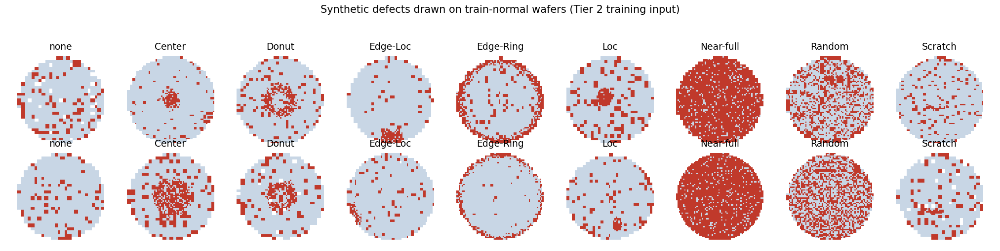

# Tier 2：CNN（合成 defect，只用正常樣本訓練）

> 1. 第 3 節的數字是主結果表中 Tier 2 的那一列。
> 2. 第 5 節是和 Tier 1 的公平比較，第 6 節是 ablation（Conv Autoencoder），都可以直接寫進 paper。
>
> 對應程式：[`src/CNN.py`](../src/CNN.py)｜參考實作：根目錄的 `Python code.ipynb`（Keras 9 類監督式 CNN，非本組撰寫，未放進 repo）
> 最後更新：2026-10-26

---

## TL;DR

| 方法 | PR-AUC | ROC-AUC | F1 | Recall | FPR |
|---|---:|---:|---:|---:|---:|
| T1b Fail-rate（best-F1） | 0.474 | 0.748 | 0.423 | 0.407 | 0.089 |
| **T2 CNN（合成 defect）** | **0.818 ± 0.014** | **0.934 ± 0.009** | **0.748 ± 0.008** | **0.735 ± 0.013** | **0.040 ± 0.005** |
| T2 ablation：Conv AE | 0.462 ± 0.048 | 0.703 ± 0.047 | 0.428 ± 0.049 | 0.339 ± 0.059 | 0.041 ± 0.009 |

（3 個 seed 的 mean ± std，test set）

- **訓練時只用 train 的正常晶圓**（87,970 片），沒有使用任何真實 defect label。8 類 defect 都是在正常晶圓上**即時合成**的。
- **明顯優於 Tier 1**：PR-AUC +0.34，bootstrap 95% CI [0.348, 0.377]。誤報率對齊在 Tier 1 的 8.9% 時，recall 從 0.41 升到約 0.83。
- **H2 / H3 獲得支持**：Edge-Ring 27% → 89%，Scratch 9% → 63%。最弱的類別變成 Edge-Loc（55%）。
- **Conv AE 沒有贏過 Tier 1**：重建誤差會被 normal 晶圓本身約 10% 的隨機壞 die 淹沒。這個結果支持「要學的是 pattern，而不是壞多少」。

---

## 1. 如何重現

在 Colab 上執行（執行階段選 GPU）：

```python
!git clone -b CNN https://github.com/justinlin9299/DM-HW2.git
%cd DM-HW2
!python -u src/CNN.py --out /content/drive/MyDrive/DM-HW2/results/tier2              # 主方法，3 seeds
!python -u src/CNN.py --method ae --out /content/drive/MyDrive/DM-HW2/results/tier2  # ablation
!python src/CNN.py --limit 3000 --epochs 1 --seeds 0                                 # 1 分鐘 smoke test（結果不能拿來報告）
```

前提：`data/processed/*.npz` 已在 repo 中。只需要 PyTorch，Colab 已內建。

**斷線續跑**：每個 epoch 都會存 checkpoint。斷線後用**完全相同的指令**重跑：已完成的 seed 會跳過，中斷的 seed 從最後一個 epoch 接續。改了超參數時要換一個 `--out`，否則會沿用舊結果。

輸出（`results/tier2/<method>/`，`method` = `synth` 或 `ae`，格式和 `results/tier1/` 一致）：

| 檔案 | 內容 |
|---|---|
| `metrics.csv` | 每個 seed 一列，加上 mean、std 兩列：所有 metric、τ、混淆矩陣、ms/sample、訓練秒數、best epoch、val PR-AUC |
| `per_type_recall.csv` | 各 failureType 的偵測率（各 seed、mean、std；`none` 那列 = 誤報率） |
| `scores_test.csv` | 每筆 test 的 index、failureType、label、各 seed 的 score 與預測結果。**§8 挑 FP / FN 案例時用** |
| `history_seed*.csv` | 每個 epoch 的 train loss、val PR-AUC（訓練曲線） |
| `model_seed*.pt` | 最佳權重（依 val PR-AUC 選） |
| `figures/tier2/synthetic_examples.{png,pdf}` | 合成 defect 的範例圖（見 2.2 節） |

`result_seed*.pt`、`ckpt_seed*.pt` 只用於斷線續跑，沒有放進 repo。

---

## 2. 方法設計

### 2.1 問題：參考實作不能直接用

參考 notebook 是**監督式 9 類分類器**，訓練時用了真實的 defect label，違反 Tier 2 的規則（[split.md](split.md) §5：one-class 模型**只能**用 train 且 `y == 0`）。所以我們保留它的架構和合成 defect 的想法，但改成**只看正常樣本**的訓練方式：

| | 參考 notebook | 本實作 |
|---|---|---|
| 訓練資料 | 真實的 9 類 label（含 defect） | **只有 train normal** |
| defect 從哪來 | 真實樣本 + 在一張固定模板上手工畫 5 類（Donut、Loc、Near-full、Random、Scratch） | **8 類全部合成**，每個 batch 隨機拿真實的正常晶圓當底圖 |
| 架構 | Model 6：Conv(16-32-64) + BN + ReLU + MaxPool + GlobalMaxPool + 9 類 softmax | 相同，再加一層 128（輸入是 64×64，不是 53×52） |
| 增強 | flip + rot90，事先存成 PNG | 在 GPU 上即時做 8 種 flip/旋轉 |
| 訓練 | Adam，EarlyStopping(val_loss) | AdamW + cosine LR + 混合精度，EarlyStopping(val PR-AUC) |

### 2.2 合成 defect

每個 batch 有一半的晶圓會被畫上一種隨機選的 defect（8 類機率相同），另一半維持正常。畫法是：先以各晶圓自己的中心算出正規化半徑 r（最外圈 die 的 r = 1，定義和 [eda.md](eda.md) §2 相同）和角度 θ，再依各類別的形狀，讓區域內的良品 die 以機率 d 變成不良 die。**原本的隨機壞 die 都保留**，所以 defect 是疊在真實的良率損失背景上。

| 類別 | 區域 | 不良機率 d |
|---|---|---|
| Center | r < 0.15–0.45 | 0.6–0.95 |
| Donut | r₁ < r < r₁ + w，r₁ = 0.15–0.4，w = 0.12–0.3 | 0.5–0.9 |
| Edge-Ring | r > 1 − (0.08–0.2) | 0.65–0.95 |
| Edge-Loc | 外圈寬 0.15–0.35，角度範圍 ±15°–36° | 0.7–0.95 |
| Loc | 一個橢圓團塊，中心 r ≤ 0.65，半徑 0.08–0.22R（不碰到外圈，避免變成 Edge-Loc） | 0.6–0.95 |
| Random | 整片 | 0.2–0.5 |
| Near-full | 整片 | 0.8–0.98 |
| Scratch | 兩段折線，總長 0.15–0.9R，寬約 2–3 px | 0.85–1.0 |

r 會加上小幅雜訊（σ = 0.04），讓邊界不規則。形狀參考 [eda.md](eda.md) Fig 3 的各類平均圖。



### 2.3 Anomaly score 與 τ

- 模型輸出 9 類 logits（0 = none，1–8 = 合成 defect 類別）。
- **Score**：

  $$s(x) = \log \sum_{k=1}^{8} e^{z_k} - z_0 = \log \frac{P(\text{any defect} \mid x)}{P(\text{none} \mid x)}$$

  越高越異常，可以直接接 `evaluate.py`。
- **τ**：在 val 上用 `find_best_f1_threshold` 選。
- **Early stopping**：每個 epoch 算 val PR-AUC，保留最好的那個 epoch，patience = 5。
- 兩者都只用 val（[split.md](split.md) §5 允許用 val 的 defect label 調 τ 和 early stopping），test 只評估一次。

### 2.4 超參數

| 項目 | 值 |
|---|---|
| 輸入 | 64×64 one-hot 3 channel（同 `data.to_onehot`） |
| 寬度 | 16-32-64-128，參數量 98,841 |
| Optimizer | AdamW，lr 1e-3，weight decay 1e-4，cosine 衰減 |
| Batch | 256（其中 50% 合成 defect） |
| Epochs | 最多 30，patience 5 |
| Seeds | 0、1、2 |

全部沒有調過，都是預設值。

---

## 3. 結果（test set，34,493 片：29,397 normal / 5,096 defect）

### 主結果

| 方法 | PR-AUC | ROC-AUC | F1 | Precision | Recall | FPR | Accuracy | ms / sample | 訓練時間 |
|---|---:|---:|---:|---:|---:|---:|---:|---:|---:|
| T2 CNN seed 0 | 0.837 | 0.944 | 0.753 | 0.755 | 0.751 | 0.042 | 0.927 | 0.016 | 77 s |
| T2 CNN seed 1 | 0.803 | 0.933 | 0.737 | 0.740 | 0.734 | 0.045 | 0.923 | 0.014 | 64 s |
| T2 CNN seed 2 | 0.814 | 0.923 | 0.753 | 0.790 | 0.719 | 0.033 | 0.930 | 0.014 | 115 s |
| **mean ± std** | **0.818 ± 0.014** | **0.934 ± 0.009** | **0.748 ± 0.008** | 0.762 ± 0.021 | **0.735 ± 0.013** | **0.040 ± 0.005** | 0.927 | 0.014 | 86 s |

- 計算成本是在 Colab GPU 上量的，Tier 1 是在 CPU 上量的，所以 ms/sample 不能直接比。
- Best epoch 分別是 7、5、13，val PR-AUC 0.827 / 0.795 / 0.810，和 test 很接近。

### 混淆矩陣（mean）

| TP | FP | FN | TN |
|---:|---:|---:|---:|
| 3,745 | 1,178 | 1,351 | 28,219 |

### 各類別偵測率

| failureType | n (test) | T1b best-F1 | T2 CNN（mean ± std） |
|---|---:|---:|---:|
| none（= 誤報率） | 29,397 | 0.089 | **0.040 ± 0.005** |
| Edge-Loc | 991 | 0.380 | 0.553 ± 0.023 |
| Loc | 726 | 0.333 | 0.624 ± 0.030 |
| Scratch | 251 | 0.092 | **0.627 ± 0.013** |
| Center | 899 | 0.681 | 0.646 ± 0.026 |
| Edge-Ring | 1,887 | 0.267 | **0.892 ± 0.033** |
| Donut | 100 | 0.750 | 0.930 ± 0.022 |
| Random | 211 | 0.995 | 0.945 ± 0.028 |
| Near-full | 31 | 1.000 | 1.000 ± 0.000 |

注意：兩欄的 τ 不同（Tier 2 的誤報率只有 Tier 1 的一半），所以單一類別不能直接比。對齊誤報率後的比較見第 5 節。

---

## 4. 解讀

1. **H2 證實：位置 / 形狀資訊是關鍵**。Edge-Ring 是數量最多的 defect，偵測率從 27% 升到 89%，而且誤報率反而降低。Tier 1 的 fail rate 只知道「壞多少」，CNN 看得到「壞在哪、什麼形狀」。
2. **H3 部分證實**。Scratch 從 9.2%（等於隨機）升到 63%。GlobalMaxPool 讓模型具有平移不變性，所以不管刮痕出現在哪裡，都有機會被抓到。但 Scratch 和 Loc 仍然是較難的類別，符合預期。
3. **新的最弱類別是 Edge-Loc（55%）**。可能的原因：
   - 真實的 Edge-Loc 和合成版本（外圈一段扇形）差異較大
   - 和 normal 晶圓外圈本來就比較多壞 die 的情況（eda.md 中位數 `edge_fail_rate` 0.157）不容易區分

   §8 可以用 `scores_test.csv` 篩出漏抓的 Edge-Loc 來確認。
4. **Random 從 99.5% 降到 94.5%**。Tier 1 的 fail rate 本來就最適合 Random，CNN 在較嚴格的 τ 下漏掉少數密度較低的 Random。對齊誤報率後的差距見第 5 節。
5. **不穩定性**：train loss 在第 2 個 epoch 就降到約 0.06，代表模型很快就學會區分合成 defect。之後 val PR-AUC 在 0.68–0.83 之間跳動（見 `history_seed*.csv`），early stopping 挑到的是峰值。不過 test 和 val 的 PR-AUC 幾乎一樣（0.818 vs 0.811），沒有因此高估。可能的改善方向：降低 learning rate、權重 EMA、讓合成 defect 更難（密度更低、範圍更小）。

---

## 5. 和 Tier 1 的公平比較

### 不受 τ 影響

| | Tier 1 | Tier 2 | 差距 |
|---|---:|---:|---:|
| PR-AUC | 0.474 | 0.818 ± 0.014 | **+0.344** |
| ROC-AUC | 0.748 | 0.934 ± 0.009 | +0.186 |

在 test 上做 1000 次 bootstrap（Tier 2 用 seed 0），PR-AUC 差距的 **95% CI 為 [0.348, 0.377]**，1000 次中最小的差距是 0.335。差距遠大於 seed 之間的波動（std 0.014），不是隨機造成的。

### 誤報率對齊在 Tier 1 的 8.9%

把 Tier 2 的 τ 設成「test normal 的誤報率剛好 8.9%」，再比較 recall。這只用來分析，不是正式的 τ 選擇方式：

| | Tier 1 | Tier 2 seed 0 | seed 1 | seed 2 |
|---|---:|---:|---:|---:|
| 整體 recall | 0.407 | **0.848** | **0.825** | **0.821** |
| Center | 0.681 | 0.803 | 0.814 | 0.798 |
| Scratch | 0.092 | 0.725 | 0.709 | 0.725 |
| Edge-Loc | 0.380 | 0.726 | 0.678 | 0.683 |
| Loc | 0.333 | 0.751 | 0.764 | 0.716 |

在相同的誤報率下，Tier 2 抓到的 defect 是 Tier 1 的兩倍以上，而且列出的每一類都比較好。第 3 節中 Center 看起來略低（0.646 vs 0.681），只是因為 Tier 2 的 τ 比較嚴格。

### 公平性說明（paper 要交代）

- **val 的使用量不同**：Tier 2 用 val 的 label 做 early stopping 和選 τ，Tier 1 只用來選 τ。兩者都符合規則，但 Tier 2 從 val 拿到的資訊比較多。test 和 val 的分數接近，沒有過擬合 val 的跡象。
- **領域知識**：合成 defect 用到了「8 類 defect 大概長什麼樣」的先驗知識（參考 EDA Fig 3），但**沒有使用任何真實的 anomaly 樣本**。這屬於 self-supervised 的合成異常方法，和 CutPaste、DRAEM 是同一類。

---

## 6. Ablation：Conv Autoencoder（`--method ae`）

純 one-class 的重建方法：只學重建正常晶圓，不使用合成 defect。

- **架構**：Encoder Conv(32-64-128) + MaxPool → 64 維 latent → ConvTranspose decoder，參數量 1,331,779。
- **Loss**：pixel-wise cross-entropy（像素是類別，不用 MSE）。
- **Score**：晶圓範圍內的 pixel CE → 5×5 avg-pool → 取最大的 16 個值平均。這樣聚集的錯誤會被放大，散落的錯誤會被稀釋。

| 方法 | PR-AUC | ROC-AUC | F1 | Recall | FPR | ms / sample | 訓練時間 |
|---|---:|---:|---:|---:|---:|---:|---:|
| T2 CNN（合成 defect） | **0.818 ± 0.014** | **0.934 ± 0.009** | **0.748 ± 0.008** | **0.735 ± 0.013** | 0.040 | 0.014 | 86 s |
| T2 Conv AE | 0.462 ± 0.048 | 0.703 ± 0.047 | 0.428 ± 0.049 | 0.339 ± 0.059 | 0.041 | 0.073 | 332 s |
| T1b Fail-rate | 0.474 | 0.748 | 0.423 | 0.407 | 0.089 | — | — |

| failureType | Conv AE（mean ± std） |
|---|---:|
| none（誤報率） | 0.041 ± 0.009 |
| Scratch | 0.128 ± 0.121 |
| Donut | 0.217 ± 0.135 |
| Loc | 0.227 ± 0.194 |
| Edge-Loc | 0.242 ± 0.070 |
| Edge-Ring | 0.332 ± 0.068 |
| Random | 0.434 ± 0.096 |
| Center | 0.585 ± 0.026 |
| Near-full | 0.806 ± 0.190 |

**解讀：**
- AE 的 PR-AUC 甚至略低於 Tier 1。normal 晶圓本身就有約 10% 隨機分布的壞 die，AE 無法重建這些雜訊，所以 normal 的重建誤差本來就很高，和 defect 的差距被淹沒了。
- **Scratch 只有 13%**，符合 [eda.md](eda.md) §7 的預警：細線在重建時很容易被平滑掉。
- 合成 defect 的做法等於**直接告訴模型「哪種錯誤是重要的」**。這是兩者差距 0.36 的主因。
- **限制**：AE 三個 seed 的差異很大（PR-AUC 0.41–0.53）。seed 2 跑到第 30 個 epoch 還在進步，另外兩個 seed 是在 val 的雜訊波動中被 early stop 停掉的。所以這個數字代表的是「這個設定下的結果」，不是 AE 能做到的上限。

---

## 7. 給 paper 的素材

- **§5 Method**：
  - 第 2.1 節的「參考實作 vs 本實作」表
  - 第 2.2 節的合成規則表和 `synthetic_examples` 圖
  - 第 2.3 節的 score 公式
- **§6 Experimental Setup**：第 2.4 節的超參數；只用 train normal、val 只做 early stopping 和 τ、3 個 seed。
- **§7 Main results**：第 3 節主結果表的 mean ± std 那一列。
- **§7 Ablation**：第 6 節的 CNN vs AE。如果要加 threshold strategy ablation，可以用 `scores_test.csv` 比較不同 τ 的取法。
- **§7 Comparison with Tier 1**：第 5 節的 bootstrap CI 和「誤報率對齊下的 recall」表。
- **§8 Error analysis**：
  - `scores_test.csv` 篩出漏抓的 Edge-Loc、Scratch、Loc
  - 篩出分數很高的 normal（FP）
  - 依 dieSize 分組，看 H4 的捷徑特徵是否存在
- **訓練曲線**：用 `history_seed*.csv` 畫 val PR-AUC vs epoch，說明第 4 節第 5 點的不穩定性。
